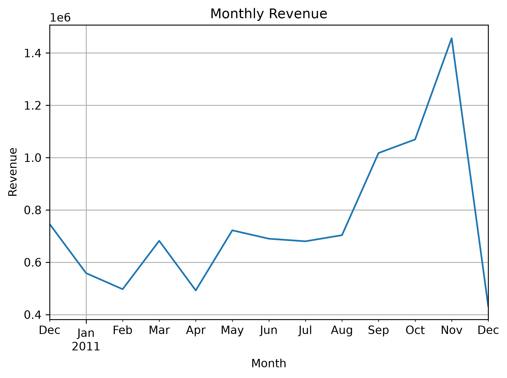
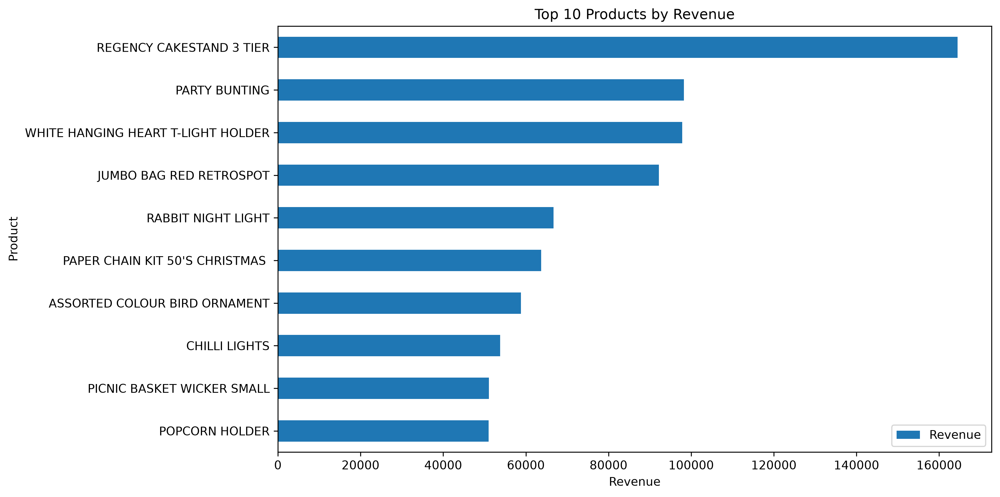
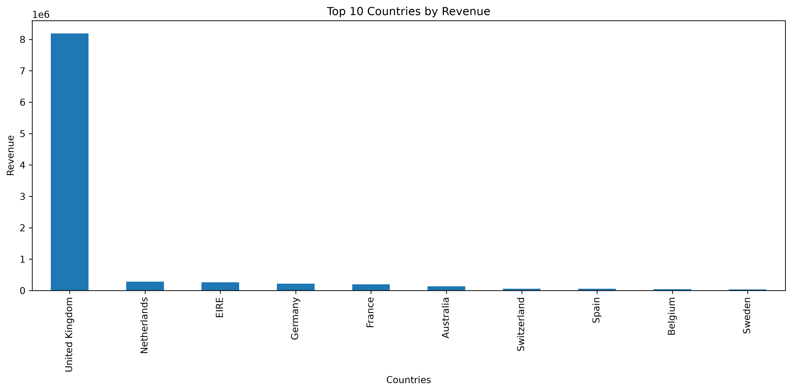

# Анализ продаж интернет-магазина Online Retail

## Цель исследования

Проанализировать продажи интернет-магазина: изучить динамику выручки по месяцам, выявить наиболее прибыльные товары, определить страны, формирующие основную выручку, рассчитать средний чек и оценить частоту повторных покупок.

## Данные

Исходный набор данных содержит следующие столбцы: InvoiceNo, StockCode, Description, Quantity, InvoiceDate, UnitPrice, CustomerID, Country.

В ходе анализа были добавлены два столбца: Revenue (выручка) и Month (месяц продажи).

Период исследования: с 1 декабря 2010 года по 9 декабря 2011 года.

Данные за декабрь 2011 года представлены не полностью, поэтому снижение месячной выручки в конце периода нельзя интерпретировать как реальное падение продаж.

## Подготовка данных

В ходе подготовки данных к исследованию были удалены полные дубликаты строк.

Для расчёта общей выручки были сохранены строки с положительным значением Quantity, а также строки с отрицательным Quantity, у которых номер документа начинается с C (возвраты и отмены).

Строки с отрицательным значением UnitPrice были исключены из анализа.

Были созданы два новых столбца:

Revenue — для расчёта выручки по каждой строке как произведения Quantity и UnitPrice.

Month — для группировки выручки по месяцам.

Строки с отсутствующим CustomerID были сохранены для анализа общей выручки, но исключены при расчёте показателей повторных покупок.

## Результаты анализа

Общая выручка интернет-магазина за исследуемый период составила 9 748 131,07.

Самым прибыльным месяцем стал ноябрь 2011 года с выручкой 1 456 145,80. С сентября по ноябрь 2011 года наблюдался заметный рост выручки.

Данные за декабрь 2011 года представлены не полностью, поэтому снижение выручки на графике нельзя однозначно интерпретировать как реальное падение продаж.

### Топ-10 товаров по выручке

Лидером по выручке является REGENCY CAKESTAND 3 TIER с выручкой 164 459,49. Второе место занимает PARTY BUNTING с выручкой 98 243,88.

### Выручка по странам

На Великобританию (United Kingdom) приходится 84,01% общей выручки интернет-магазина. Это говорит о высокой зависимости бизнеса от британского рынка.

Такая концентрация создаёт потенциальный риск: снижение спроса, ухудшение экономической ситуации или изменение условий торговли в Великобритании могут существенно повлиять на общую выручку магазина.

### Покупатели и заказы

Средний чек покупки составил 513,47, а медианный — 297,34. Значительная разница между этими показателями указывает на влияние крупных заказов, которые повышают среднее значение.

Средний и медианный чек рассчитаны по заказам с положительным количеством товаров, без учёта документов возврата.

Половина заказов имеет стоимость не выше 297,34. Таким образом, медианный чек лучше характеризует стоимость типичной покупки, тогда как средний чек зависит от крупных заказов.

Заказы стоимостью более 1 000 составляют 8,84% от общего количества, то есть крупные покупки встречаются относительно редко.

65,57% покупателей с известным CustomerID совершали как минимум две покупки за исследуемый период. Среднее количество заказов на одного покупателя с известным CustomerID составило 4,27.

## Основные выводы и рекомендации

По результатам анализа продаж интернет-магазина Online Retail были сделаны следующие выводы:

1. С сентября по ноябрь 2011 года наблюдался рост выручки. Наибольшая месячная выручка зафиксирована в ноябре 2011 года — 1 456 145,80. Рост продаж с сентября по ноябрь может быть связан с сезонным спросом. Рекомендуется изучить продажи за другие годы, чтобы проверить эту гипотезу.

2. Выручка сильно зависит от британского рынка. На Великобританию приходится 84,01% общей выручки. Для снижения зависимости от одного рынка можно рассмотреть развитие продаж в других странах.

3. Крупные заказы заметно влияют на средний чек. Средний чек составляет 513,47, а медианный — 297,34.
   Рекомендуется использовать оба показателя: средний чек — для оценки средней стоимости заказа, медианный — для понимания стоимости типичной покупки.

4. Повторные покупки распространены среди клиентов с известным CustomerID: 65,57% из них совершили как минимум два заказа за исследуемый период.
   Рекомендуется изучить поведение постоянных клиентов и определить, какие товары они покупают чаще всего.

## Ограничения исследования

Данные охватывают период чуть больше одного года, причём декабрь 2011 года представлен не полностью. Это ограничивает возможности анализа сезонности.

Часть записей не содержит CustomerID, поэтому показатели повторных покупок рассчитаны только для клиентов с известным идентификатором.

Полученные результаты позволяют выявить закономерности в продажах, но не дают возможности однозначно определить причины изменения спроса.

## Итог

Анализ позволил определить основные источники выручки, наиболее успешные товары и особенности покупательского поведения. Полученные результаты могут использоваться для дальнейшего изучения спроса, планирования ассортимента и развития продаж.
